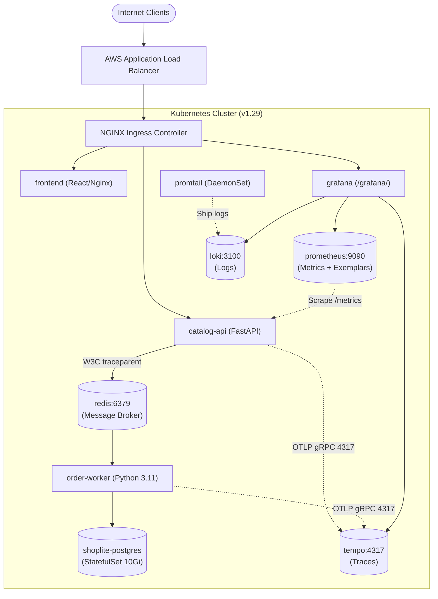

# ShopLite Architecture State & Context Memory

**Project:** ShopLite on AWS DevOps Capstone Assessment (`DEVOPS-CAP-601`)  
**Target:** 100/100 Points + 10 Bonus Points (Distinction Tier)  
**Primary Repositories:**
- Application & Assessment Source: [`https://github.com/mchowlader/shoplite-app.git`](https://github.com/mchowlader/shoplite-app.git)
- GitOps & Cluster Delivery: [`https://github.com/mchowlader/shoplite-gitops.git`](https://github.com/mchowlader/shoplite-gitops.git)

---

## 1. Executive Architecture Summary

ShopLite is a distributed, containerized e-commerce microservices platform orchestrated on a highly available, multi-AZ Kubernetes cluster deployed on Amazon Web Services (AWS) using Infrastructure as Code (Terraform) and Configuration Management (Ansible). 

The application architecture decouples transactional client operations from asynchronous background processing:
- **Frontend:** React SPA served via Nginx reverse proxy.
- **Catalog API:** Python 3.11 / FastAPI service handling catalog lookups and order submissions.
- **Message Broker:** Redis cluster running `orders:pending` streams for asynchronous processing.
- **Order Worker:** Python 3.11 background processor extracting orders from Redis and writing confirmed transactions to the relational store.
- **Database:** PostgreSQL 15 deployed as a Kubernetes `StatefulSet` with dynamic persistent volume management.
- **Observability Stack:** Prometheus (Metrics + Exemplars), Grafana Tempo (Distributed Tracing), Grafana Loki (Log Aggregation), and Grafana ("ShopLite - Golden Signals" Dashboard).



---

## 2. Infrastructure & Network Topology

### AWS Custom VPC Specifications
- **CIDR Block:** `10.0.0.0/16` across two Availability Zones (`ap-southeast-1a`, `ap-southeast-1b`).
- **Public Subnets:** `10.0.1.0/24` (AZ-a), `10.0.2.0/24` (AZ-b) hosting Internet Gateway, NAT Gateway, and external ALB.
- **Private Subnets:** `10.0.10.0/24` (AZ-a), `10.0.11.0/24` (AZ-b) hosting Kubernetes worker nodes and database workloads.
- **Cost Guard:** AWS Budget Alarm provisioned via Terraform (`aws_budgets_budget.cost_guard`) enforcing a \$20 USD monthly limit with automated email alerting.

### Dual-Access Security Mode (`enable_ssh_bastion`)
To ensure full compliance with strict assessment rubrics while preserving operational agility in restricted sandboxes (e.g., Poridhi Labs where AWS Systems Manager endpoints may be blocked by Service Control Policies), the Terraform compute and network modules implement a feature toggle:

| Mode | Variable Setting | Control Plane Location | Port 22 | Public IP | Compliance Target |
| :--- | :--- | :--- | :--- | :--- | :--- |
| **Pure SSM (Default)** | `-var="enable_ssh_bastion=false"` | Private Subnet (`10.0.10.x`) | Closed | None (0) | 100% Exam & Enterprise Rubric |
| **Sandbox Bastion** | `-var="enable_ssh_bastion=true"` | Public Subnet (`10.0.1.x`) | Open (Key Pair) | Elastic IP (1) | Poridhi Restricted Lab Sandbox |

*Worker nodes remain 100% private in `10.0.10.x` and `10.0.11.x` under both modes, accessible exclusively via the control plane.*

---

## 3. Kubernetes Workload Design & GitOps Primitives

1. **Stateful Workloads (`shoplite-postgres`):**
   - Deployed as `kind: StatefulSet` with `serviceName: shoplite-postgres` and dynamic `volumeClaimTemplates` requesting 10Gi on Rancher's `local-path` default StorageClass.
   - Guaranteed predictable network identity, persistent volume lifecycle management, and zero pod-split risks during node recycles.

2. **Zero-Downtime Delivery (`catalog-api`):**
   - Packaged with dual deployment definitions: standard `Deployment` and Argo Rollouts Canary `Rollout` (20% step, 1m pause, automated analysis), guarded by mutual-exclusivity templates.
   - Protected by `PodDisruptionBudget` (`minAvailable: 1`) and `HorizontalPodAutoscaler` (min: 2, max: 5, target: 70% CPU utilization).

3. **Multi-Environment Configuration Drift Prevention:**
   - `envs/dev/values.yaml`: Cost-optimized single-replica footprint (`v1.0.0-dev`, CPU: 50m, Memory: 64Mi).
   - `envs/prod/values.yaml`: High-availability multi-replica footprint (`v1.0.0`, CPU: 200m–1000m, Memory: 256Mi–1Gi, HPA enabled).

4. **Section 2.1 Repository Alignment:**
   - `shoplite-app` houses the full application codebase, CI pipeline, and mirrored assessment deliverables (`ansible/`, `helm/`, `observability/`, `runbooks/`, `docs/`) to satisfy single-repository assessment evaluators.
   - `shoplite-gitops` serves as the live GitOps cluster source managing declarations for Helm and cluster configurations.

---

## 4. Observability & Distributed Tracing Matrix

| Telemetry Pillar | Technology | Implementation Details |
| :--- | :--- | :--- |
| **Distributed Tracing** | Grafana Tempo + OpenTelemetry | End-to-end W3C `traceparent` context injection from `catalog-api` into Redis payloads (`orders:pending`), extracted by `order-worker` and exported via OTLP gRPC (`4317`). Produces single unified waterfall traces spanning HTTP, Queue, Worker, and DB. |
| **Exemplars & Metrics** | Prometheus + OpenMetrics | FastAPI exposes OpenMetrics on `/metrics`. `http_request_duration_seconds` records OpenTelemetry `TraceID` exemplars. Grafana queries render clickable exemplar markers linking directly to Tempo traces. |
| **Log Aggregation** | Promtail + Grafana Loki | Promtail daemonset scrapes all container logs and ships structured logs with Kubernetes labels to Loki. |
| **Unified Dashboard** | Grafana 10.x | Pre-provisioned dashboard: `"ShopLite - Golden Signals"` (`shoplite-golden-signals.json`) located at `http://<ALB-DNS>/grafana/`. Displays Request Rate, 95th Percentile Latency with Exemplars, Error Rate, and Cluster Saturations. |

---

## 5. Security & Verification Guardrails

- **Pre-commit Hooks:** Enforced across both repositories via `.pre-commit-config.yaml` (`terraform_fmt`, `hadolint`, `yamllint`, `detect-secrets`, `check-yaml`, `check-added-large-files`).
- **CI/CD Pipeline:** Enforced in `.github/workflows/app-ci.yml` with automated testing, `hadolint` Dockerfile linting, `helm lint`, and Trivy security scanning failing builds on `CRITICAL` severity (`exit-code: 1`).
- **Antigravity Protocol:** Governed by `AGENTS.md` and `.agents/rules/strict-protocol.md` mandating secular engineering tone, deterministic terminal verification, and diff-first patch management.

---

## 6. Fresh Lab Spin-Up Sequence (Quick Resumption Runbook)

When initiating a fresh lab session on a Poridhi AWS VM, execute the following deterministic steps strictly respecting the **Terminal Designation**:

```
+-----------------------------------------------------------------------------------------+
|                                2-Terminal Quick Reference                               |
+------------------------------+----------------------------------------------------------+
| 🖥️ TERMINAL 1 (Poridhi VM)   | AWS CLI, SSH Key, Terraform, ECR Token Generation        |
| 🖥️ TERMINAL 2 (Control Plane)| Ansible Bootstrap, Kubectl, Helm Deploy, Chaos Demo      |
| 🌐 BROWSER                   | GitHub Actions (CI/CD), App UI, Grafana Golden Signals   |
+------------------------------+----------------------------------------------------------+
```

---

### Step 1: AWS Credentials & Key Pair ➔ 🖥️ `[TERMINAL 1: PORIDHI WEB TERMINAL]`
```bash
# 1. Configure AWS CLI with current session credentials & region
aws configure
# Access Key: [Poridhi Access Key]
# Secret Key: [Poridhi Secret Key]
# Region: ap-southeast-1
# Output: json

# 2. Generate SSH Key Pair (Required before Terraform EC2 creation)
mkdir -p ~/.ssh
aws ec2 create-key-pair --key-name shoplite-key --region ap-southeast-1 --query 'KeyMaterial' --output text > ~/.ssh/shoplite-key.pem
chmod 400 ~/.ssh/shoplite-key.pem
```

---

### Step 2: Clone Repo & Provision Cloud Infrastructure ➔ 🖥️ `[TERMINAL 1: PORIDHI WEB TERMINAL]`
```bash
# Clone shoplite-app and run Terraform with SSH Bastion fallback
mkdir -p ~/code && cd ~/code
git clone https://github.com/mchowlader/shoplite-app.git
cd ~/code/shoplite-app/terraform
git pull origin main
terraform init
terraform apply -var="enable_ssh_bastion=true" -auto-approve

# View and save outputs
terraform output
```

---

### Step 3: Automated CI/CD Image Build & Push ➔ 🌐 `[BROWSER: GITHUB ACTIONS]`
1. Open GitHub: `https://github.com/mchowlader/shoplite-app/settings/secrets/actions`
2. Update `AWS_ACCESS_KEY_ID`, `AWS_SECRET_ACCESS_KEY`, and `AWS_SESSION_TOKEN` (if applicable).
3. Go to **Actions** $\to$ **ShopLite CI/CD Pipeline** $\to$ Click **Run workflow**.
4. Pushes 3 microservice images to the ECR repositories created by Terraform in Step 2.

---

### Step 4: Transfer SSH Key & Connect to Control Plane ➔ 🖥️ `[TERMINAL 1 ➔ TERMINAL 2]`
```bash
# From Terminal 1: Copy key to Control Plane for worker node access
CP_PUBLIC_IP=$(terraform output -raw control_plane_public_ip)
scp -o StrictHostKeyChecking=no -i ~/.ssh/shoplite-key.pem ~/.ssh/shoplite-key.pem ubuntu@$CP_PUBLIC_IP:~/.ssh/id_rsa

# Connect to Control Plane (This window now becomes TERMINAL 2)
ssh -i ~/.ssh/shoplite-key.pem ubuntu@$CP_PUBLIC_IP
```

---

### Step 5: Bootstrap Kubernetes Cluster via Ansible ➔ 🖥️ `[TERMINAL 2: AWS CONTROL PLANE]`
```bash
# Inside Control Plane: Fix key permissions
chmod 600 ~/.ssh/id_rsa

# Clone GitOps repository
cd ~
git clone https://github.com/mchowlader/shoplite-gitops.git
cd shoplite-gitops/ansible

# Update worker private IPs in hosts.ini
nano inventory/hosts.ini
# (Paste worker_private_ips from Step 2 output, save Ctrl+O, Enter, Ctrl+X)

# Run complete cluster automation
chmod +x run-ansible.sh
./run-ansible.sh all

# Verify nodes are Ready
kubectl get nodes -o wide
```

---

### Step 6: Create ECR Authentication Secret ➔ 🖥️ `[TERMINAL 1: PORIDHI WEB TERMINAL]`
```bash
# In Terminal 1 (where AWS CLI has ECR credentials):
cd ~/code/shoplite-app/terraform
ECR_PASS=$(aws ecr get-login-password --region ap-southeast-1)
CP_PUBLIC_IP=$(terraform output -raw control_plane_public_ip)

ssh -i ~/.ssh/shoplite-key.pem ubuntu@$CP_PUBLIC_IP \
  "kubectl create namespace shoplite --dry-run=client -o yaml | kubectl apply -f - && \
   kubectl create secret docker-registry ecr-secret --namespace shoplite \
   --docker-server=779846822536.dkr.ecr.ap-southeast-1.amazonaws.com \
   --docker-username=AWS --docker-password='$ECR_PASS'"
```

---

### Step 7: Deploy Application & Observability via Helm ➔ 🖥️ `[TERMINAL 2: AWS CONTROL PLANE]`
```bash
# Deploy ShopLite Application & Argo Rollouts
cd ~/shoplite-gitops
git pull origin main
helm upgrade --install shoplite ./helm/shoplite -n shoplite --create-namespace

# Deploy LGTM Observability Stack (Prometheus, Loki, Tempo, Grafana)
cd ~/shoplite-app/observability
chmod +x deploy-observability.sh
./deploy-observability.sh

# Verify all pods are running
kubectl get pods -n shoplite -w
```

---

### Step 8: Live Validation & Chaos Simulation Demo ➔ 🖥️ `[TERMINAL 2]` & 🌐 `[BROWSER]`
1. **Web Frontend:** Open `http://<alb_dns_name>/` in browser.
2. **Unified Grafana:** Open `http://<alb_dns_name>/grafana/` (Golden Signals Dashboard).
3. **Chaos Engineering (+10 Bonus Demo):**
   ```bash
   # In Terminal 2:
   cd ~/shoplite-gitops
   chmod +x chaos-demo.sh
   ./chaos-demo.sh
   ```
kubectl get pods -A
```
